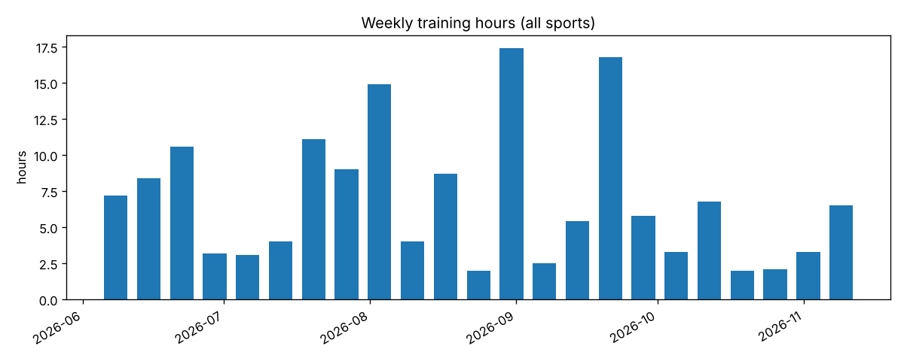
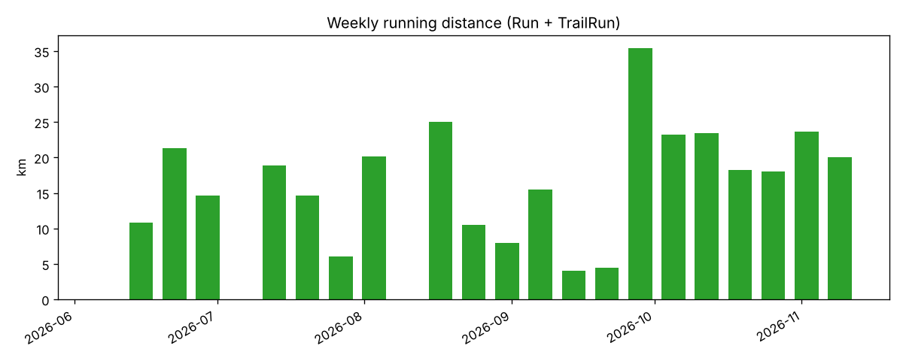
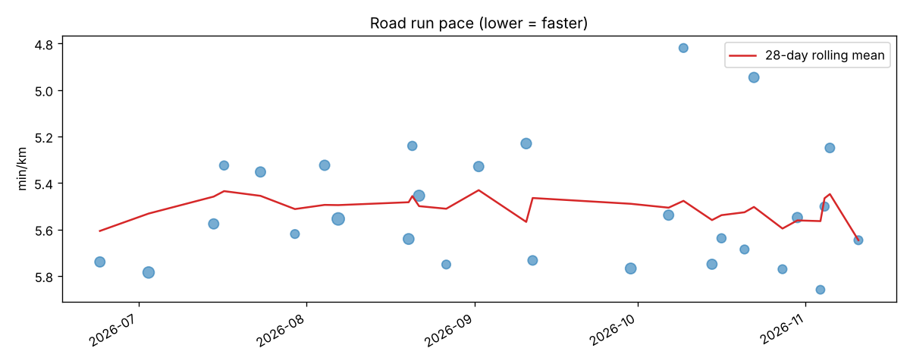

# Strava summary

2026-06-13 to 2026-11-15 — 100 activities, 158 h, 1249 km, 37945 m climbed

## By sport

| sport_type                    |   n |    km |   hours |   elev_m |   kcal |
|:------------------------------|----:|------:|--------:|---------:|-------:|
| Hike                          |  19 | 223.4 |    75.4 |  18758.3 |  36405 |
| Ride                          |  12 | 674.6 |    29.1 |   7977   |  20046 |
| TrailRun                      |  23 | 123.8 |    20.4 |   9721   |  14405 |
| Run                           |  28 | 211.9 |    19.5 |   1116   |  15980 |
| WeightTraining                |  10 |   0   |     8   |      0   |   1963 |
| HighIntensityIntervalTraining |   4 |   0   |     3.8 |      0   |    879 |
| Swim                          |   3 |   3.2 |     1.1 |      0   |    706 |
| MountainBikeRide              |   1 |  12.5 |     1   |    373   |    547 |

## Weekly

|                     |   n |   hours |   elev_m |   effort |   run_km |
|:--------------------|----:|--------:|---------:|---------:|---------:|
| 2026-06-08 00:00:00 |   1 |     7.2 |   2120.3 |        0 |      0   |
| 2026-06-15 00:00:00 |   5 |     8.4 |   2815   |      259 |     10.8 |
| 2026-06-22 00:00:00 |   6 |    10.6 |   2855   |      330 |     21.3 |
| 2026-06-29 00:00:00 |   4 |     3.2 |    398   |      141 |     14.6 |
| 2026-07-06 00:00:00 |   1 |     3.1 |    518   |        0 |      0   |
| 2026-07-13 00:00:00 |   5 |     4   |    761   |      222 |     18.9 |
| 2026-07-20 00:00:00 |   4 |    11.1 |   2712   |      233 |     14.6 |
| 2026-07-27 00:00:00 |   6 |     9   |   2372   |      190 |      6   |
| 2026-08-03 00:00:00 |   6 |    14.9 |   2813   |      335 |     20.1 |
| 2026-08-10 00:00:00 |   1 |     4   |   1160   |        0 |      0   |
| 2026-08-17 00:00:00 |   6 |     8.7 |   1628   |      274 |     25   |
| 2026-08-24 00:00:00 |   3 |     2   |    382   |      104 |     10.5 |
| 2026-08-31 00:00:00 |   7 |    17.4 |   3363   |      318 |      8   |
| 2026-09-07 00:00:00 |   4 |     2.5 |     78   |       89 |     15.5 |
| 2026-09-14 00:00:00 |   3 |     5.4 |   1059   |       85 |      4   |
| 2026-09-21 00:00:00 |   7 |    16.8 |   5060   |      545 |      4.5 |
| 2026-09-28 00:00:00 |   5 |     5.8 |   2099   |      285 |     35.4 |
| 2026-10-05 00:00:00 |   5 |     3.3 |    803   |      261 |     23.2 |
| 2026-10-12 00:00:00 |   6 |     6.8 |   1441   |      132 |     23.4 |
| 2026-10-19 00:00:00 |   3 |     2   |    427   |      130 |     18.2 |
| 2026-10-26 00:00:00 |   3 |     2.1 |    432   |      147 |     18   |
| 2026-11-02 00:00:00 |   5 |     3.3 |    455   |      146 |     23.6 |
| 2026-11-09 00:00:00 |   4 |     6.5 |   2194   |      236 |     20   |

